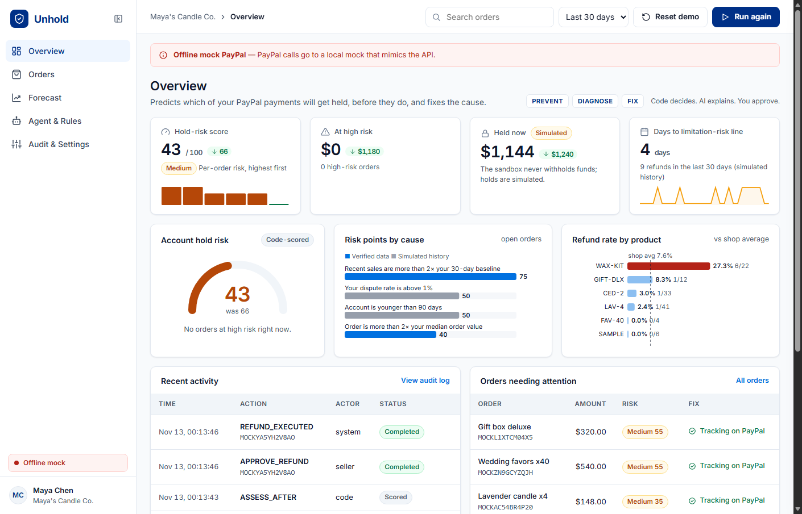
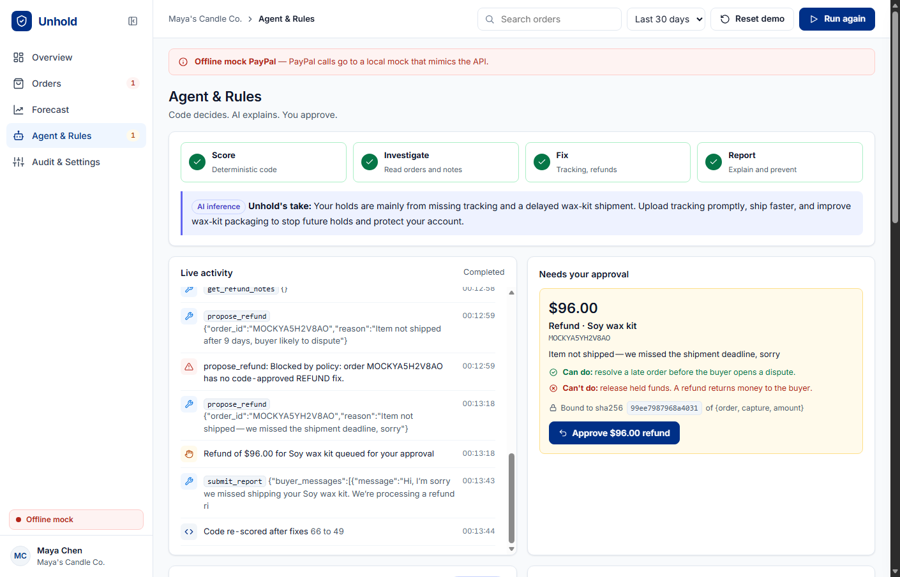
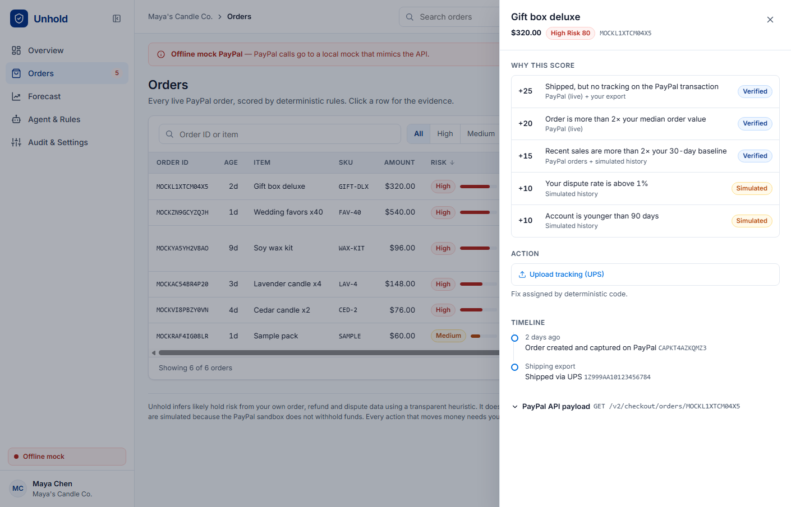

# Unhold

Unhold predicts which of a seller's PayPal payments are likely to get held, then fixes the causes before PayPal reacts.

Small sellers complain about held funds more than anything else on PayPal's community forums, and most tools only help once the money is already stuck. Unhold looks at every open order, scores its hold risk with transparent rules, finds the product behind rising refunds, and takes the steps PayPal itself recommends, such as uploading tracking. Anything that moves money waits for the seller's approval.

Built for the PayPal AI Hackathon 2026.



## Try it

The hosted demo link is in the Devpost submission. To run it locally you need Node 18+ and a free Groq API key (https://console.groq.com/keys).

```bash
git clone https://github.com/shashankbindal/unhold.git
cd unhold
npm install
cp .env.example .env     # add GROQ_API_KEY
npm start                # http://localhost:3333
```

With only a Groq key, the app runs against a built-in offline copy of the PayPal API, and a red banner says so. Demo orders are created on first start. Add PayPal sandbox credentials to make every PayPal call real (see [Using the PayPal sandbox](#using-the-paypal-sandbox)).

### A three-minute walkthrough

1. **Overview.** Look at the account risk score, the orders most likely to be held, and the charts showing what drives the risk.
2. **Forecast.** Switch on the what-if options (upload all tracking, resolve late orders, fix the problem product, or a sales surge next week) and watch the score change.
3. **Agent & Rules.** Click **Run Unhold agent**. Every tool call and PayPal response streams into the activity feed.
4. **Approve.** Approve the refund the agent proposes. The score drops (66 to 43 in the demo shop), and the Overview updates.
5. **Orders.** Click any order to see why it scored the way it did, where each piece of evidence came from, its timeline, and the raw PayPal order.
6. **Audit & Settings.** Every proposal, approval and PayPal response, each with a SHA-256 of the exact payload.
7. **Reset demo** starts over.

## How it works

Unhold splits responsibilities: code decides, the model explains, and the seller approves.

- **Scoring is plain code** (`risk.js`). Each order gets points from fixed rules (below), and the same code decides the only fix allowed for that order.
- **The model** (gpt-oss-120b on Groq, using tool calling) reads the scores, the shipping export, the refund notes and any open disputes. It then:
  - explains each score in plain English;
  - finds the product behind the refunds;
  - drafts messages to buyers of late orders;
  - calls the fixes the code allowed.
- **The server enforces the limits.** The model can only name an order. Tracking numbers come from the seller's shipping export, and refund amounts come from code. A call for an order the rules didn't flag is rejected.
- **Refunds need a click.** Each approval is tied to a SHA-256 of `{order, capture, amount}`, can be used only once, and is checked again before PayPal is called.
- **Quotes are checked.** A root-cause quote is shown only if it appears word for word in the stored refund notes.



### Risk rules

| Rule | Points |
|---|---|
| Not shipped after 7+ days (likely "item not received" dispute) | 30 |
| Not shipped after 2+ days | 15 |
| Shipped, but no tracking on the PayPal transaction | 25 |
| Order more than 2× the median order value | 20 |
| Sales more than 4× the 30-day baseline | 25 |
| Sales more than 2× the 30-day baseline | 15 |
| Product refund rate more than 2× the shop average (3+ refunds) | 15 |
| Dispute rate above 1% | 10 |
| Account younger than 90 days | 10 |

The score is capped at 100. Medium starts at 35 and high at 60. The rules follow PayPal's public guidance: holds are usually released about a day after confirmed delivery when tracking is on the transaction, and unusual selling patterns, new accounts, disputes and refunds can all lead to holds ([release a hold](https://www.paypal.com/smarthelp/article/faq3743), [money holds](https://www.paypal.com/us/webapps/mpp/money-holds)).



### What it does not claim

- PayPal's internal risk decisions are not public. The score is a transparent estimate, not PayPal's model and not a release date.
- The PayPal sandbox never actually withholds funds, so holds and the 30-day shop history (`data/history.json`) are simulated, and the app labels them that way.
- Uploading tracking helps a hold get released but doesn't guarantee it. A refund returns money to the buyer; it does not release held funds.

## PayPal APIs used

| API | Endpoint | Where |
|---|---|---|
| OAuth 2.0 | `POST /v1/oauth2/token` | `paypal.js` |
| Orders v2 | `POST /v2/checkout/orders`, `POST /v2/checkout/orders/{id}/capture`, `GET /v2/checkout/orders/{id}` | `paypal.js`, `seed.js`, `agent.js` |
| Order tracking | `POST /v2/checkout/orders/{id}/track` | `agent.js` (`upload_tracking`) |
| Payments v2 refunds | `POST /v2/payments/captures/{id}/refund` | `agent.js` (`approve`) |
| Disputes | `GET /v1/customer/disputes` | `agent.js` (`list_disputes`) |

## Tools used

- **AI model:** `openai/gpt-oss-120b`, served by Groq through its OpenAI-compatible chat completions API with tool calling. It explains the risk scores, finds product root causes in refund notes, drafts buyer messages, and runs the fixes the rules allow. `llm.js` also has an adapter for the Anthropic API if you would rather use that model provider.
- **PayPal REST APIs** (sandbox), listed above.
- **Node.js and Express**, with Server-Sent Events to stream the agent's steps to the browser.
- **Frontend:** plain HTML, CSS and JavaScript, with hand-drawn SVG charts and icons and no build step.

## Using the PayPal sandbox

1. Create a sandbox app at https://developer.paypal.com/dashboard/applications/sandbox and copy its Client ID and Secret into `.env`.
2. Create the demo orders and approve them:

```bash
npm run seed            # creates 6 sandbox orders and prints approval links
# open each link, log in with your sandbox personal (buyer) account, approve
npm run seed:capture    # captures the payments and writes data/orders.json
npm start
```

To start over in sandbox mode, run both seed commands again.

## Environment variables

| Variable | Required | Purpose |
|---|---|---|
| `GROQ_API_KEY` | yes | Runs the agent |
| `GROQ_MODEL` | no | Defaults to `openai/gpt-oss-120b` |
| `PAYPAL_CLIENT_ID`, `PAYPAL_CLIENT_SECRET` | for real PayPal calls | Sandbox app credentials. Without them, the offline mock is used |
| `PAYPAL_MODE` | no | `mock` forces the offline mock even with credentials |
| `PORT` | no | Defaults to 3000 (`.env.example` uses 3333) |

## Deploying

`render.yaml` sets up a free Render web service. In Render, choose **New → Blueprint**, pick this repo, and set `GROQ_API_KEY` (plus the PayPal variables if you have them). The free plan's disk is temporary, so the demo data resets on restart.

## Project layout

```
server.js     HTTP API and agent streaming
agent.js      agent loop, tools, approvals
risk.js       scoring rules and what-if simulator
llm.js        model adapters (Groq, Anthropic)
paypal.js     PayPal REST client and offline mock
audit.js      append-only audit log
demo.js       demo shop seeding and reset
seed.js       sandbox seeding script
public/       frontend
data/         simulated 30-day shop history
```

## License

MIT
